# RTX 5090 BF16 MoE 负载评估

## 评估边界

本分支基于 `experiment/flash-RTX5090` 的 `f44abbe4`，覆盖三层负载：独立内核、完整 MoE block，以及完整 16 层 OLMoE 架构的 prefill/decode。公开材料已移除服务器地址、登录账户、用户名路径、硬件唯一标识和采集日期。原始 Nsight 二进制与 SQLite 报告保留在未跟踪的 `run/` 目录，仓库只包含脱敏后的记录与图表。

| 层次 | 已执行内容 | 权重与输入 |
| --- | --- | --- |
| MoE block | 88 组硬件测试，36 组 Nsight Systems tracing | BF16 合成权重，受控路由 |
| 全架构推理 | 3 组原生 prefill/decode，3 组 Nsight tracing | 完整模型形状，随机 BF16 权重与固定 seed Token IDs |
| FlashGPU-Sim | 19 次成功回放（原有 13 次、compact 6 次） | 捕获真实 GPU 内核，逐元素校验 |

**全架构结果使用随机权重，不能当作训练 checkpoint 的 OLMoE 推理或文本质量结果。** 完整训练权重尚未取得，模型下载探测不能替代 checkpoint 验证。

## 负载与通信路径

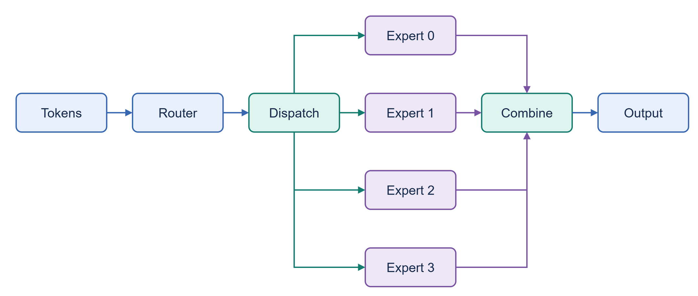

[官方配置](https://huggingface.co/allenai/OLMoE-1B-7B-0924/blob/main/config.json)的维度为 H=2048、I=1024、64 专家、每 Token 选择 8 专家、16 层。专家执行 `Down(SiLU(Gate(x)) * Up(x))`。矩阵和中间结果为 BF16，GEMM 使用 FP32 累加，无量化。单专家权重为 12 MiB，一层全部专家为 768 MiB；这些是规模公式，不是测得的 DRAM 字节数。

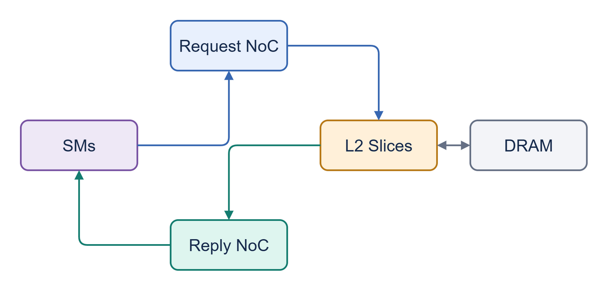

Dispatch/Combine 经 global memory 和 L2；仿真观察 SM-memory request/reply 网络。图中是逻辑路径，不是对 RTX 5090 物理拓扑的测绘。专家没有绑定到指定 SM，没有多 GPU all-to-all 或 DSM 直连通信。

均衡路由循环分配专家，随机路由使用固定 seed 且每 Token 无重复专家，热点路由将 Token 指向同一组 8 专家。合成路由权重为 1/K，不执行真实模型 router。小 Token 数不足以覆盖所有专家时，“均衡”仍只激活部分专家。无 Token dropping。

## 无 sudo 的 profiling

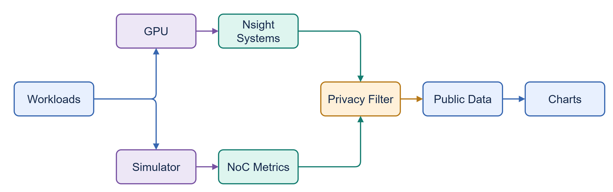

普通用户成功运行 Nsight Systems 2025.3.2 的 CUDA/NVTX activity tracing。禁用 CPU sampling 和 context-switch tracing，以 `cudaProfilerStart/Stop` 限定 warmup 后的范围。MoE block 每例捕获 3 次调用，标记 Dispatch、Gate、Up、SwiGLU、Down、Combine；全架构另标记 Prefill、Decode、Attention、MoE、Router。

Nsight Compute 2025.3.1 即使只请求 `gpu__time_duration.sum`，仍返回 `ERR_NVGPUCTRPERM`。没有使用 sudo，也没有修改驱动配置或规避访问控制。[NVIDIA 权限说明](https://developer.nvidia.com/nvidia-development-tools-solutions-ERR_NVGPUCTRPERM-permission-issue-performance-counters)与该现象一致；可用 tracing 功能见 [Nsight Systems 文档](https://docs.nvidia.com/nsight-systems/UserGuide/index.html)。

| 指标 | 数据来源 | 解释 |
| --- | --- | --- |
| 完整负载时间 | 原生 CUDA events / 同步 forward wall time | 不混入 tracing 窗口的数字 |
| 内核时间、grid、block、寄存器、shared memory | Nsight Systems CUDA activity | 不需要 GPU 性能计数器 |
| GPU 活动区间占比 | tracing 区间内 kernel 时间区间的并集 | 不是 SM occupancy 或算力利用率 |
| CUDA memcpy | CUPTI memcpy events | 不是 kernel 内部 DRAM 访问 |
| DRAM/L2 硬件计数 | NCU | 当前权限不可用，不填入推测值 |
| NoC 包、冲突、buffer 与热点 | FlashGPU-Sim | 模型中的通信行为，不是硬件测量 |

图表的 profiler 时间线包含 tracing 与 NVTX 开销，不能作为原生性能的加速比。预热后的 block 没有 host-device memcpy，也不意味着权重没有 DRAM 访问。

## MoE block 的规模与路由对照

硬件为 RTX 5090，driver 580.82.07，PyTorch 2.9.0+cu128、Triton 3.5.0。测试 Token 数为 1、16、128、512、2048。原始基线 32 组，扩展 48 组，再加 8 组调度成对对照。每组先编译与 warmup，再取 20 次 CUDA event 时间中位数；CPU 路由构造、参考计算和编译不计入时间。共享环境未锁频，跨组差异是探索性基线。

独立 FP32 参考在 BF16 中间结果边界处舍入，检查 Dispatch、专家输出及 Combine。所有 block 和调度对照均通过数值检查。

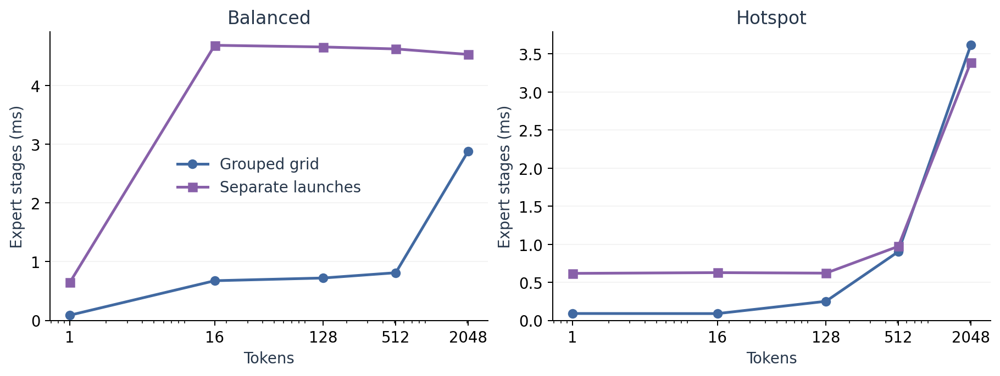

`Grouped grid` 每个投影使用一个含专家维度的 grid；`Separate launches` 按专家分别发射投影内核，包含额外 launch 成本。两者差值不能全部归于 NoC。默认 grid 按负载最大的专家铺开，短负载及倾斜路由会产生空 CTA。

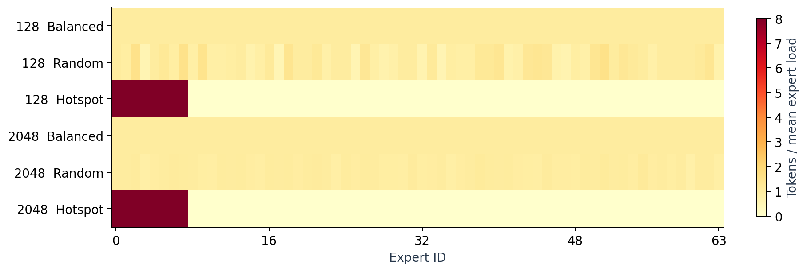

热点路由把活跃的唯一权重集合从最多 768 MiB 降到 96 MiB，并增加每个专家的 Token 数。小负载下热点运行更快，并不能证明通信热点没有代价。全架构随机权重的 GPU router 分布见后面的记录；这里的固定模式用于控制变量。

## Nsight 内核分解

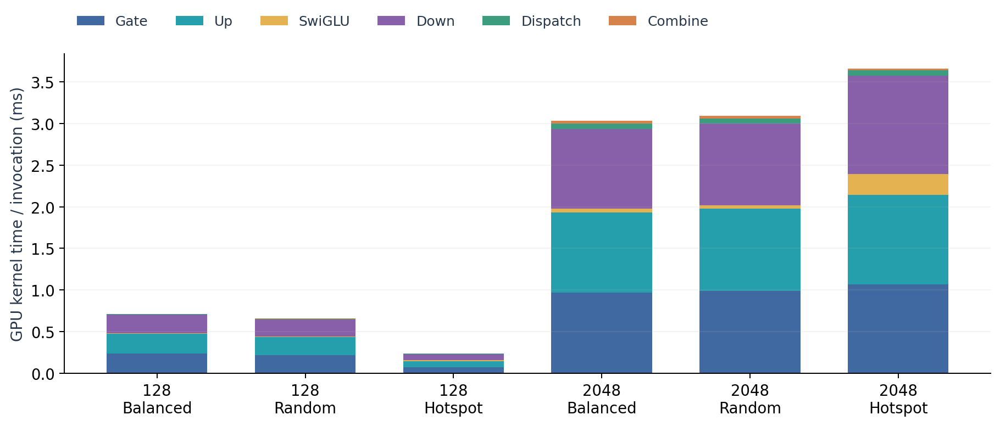

Gate、Up、Down 占大部分 GPU kernel 时间。图中是 3 次捕获调用的 kernel 时间总和除以调用次数，不是服务端响应时间。通信阶段时间小，也不能推导出 NoC 一定不重要：矩阵读取权重同样经过内存网络。

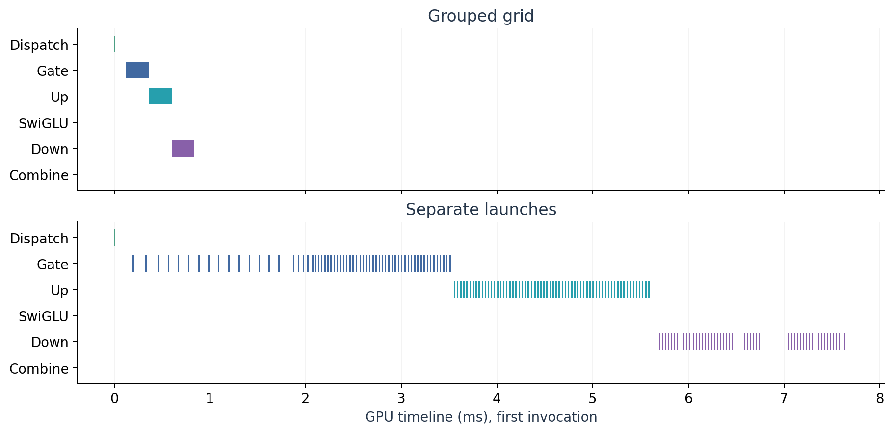

同一 T=128 均衡案例的第一条调用中，分专家发射出现明显的内核间空隙。空隙可能包含 host 调度和 profiling 开销，不能直接解释成 NoC backpressure。

## 排除空 CTA 的调度对照

新增 compact 调度只发射有效 CTA，保持有效 CTA 的 `expert → column tile → row tile` 顺序，保留相同权重、激活布局、路由和 BF16 计算。代价是每个 CTA 增加三次 tile-map 读取，因此它不是无额外访存的理想控制。

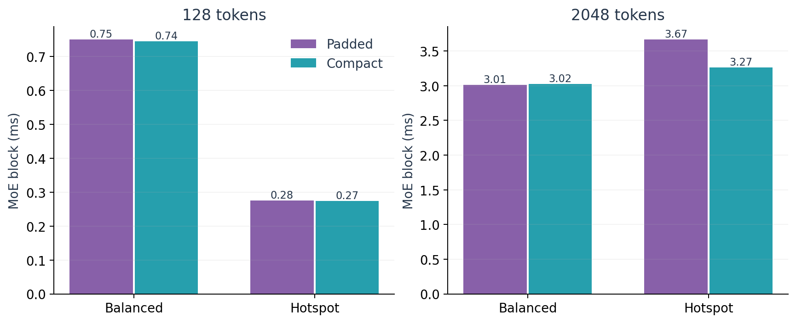

| Tokens / 路由 | Padded block ms | Compact block ms | Gate 发射 CTA：Padded / Compact |
| --- | ---: | ---: | ---: |
| 128 / 均衡 | 0.749824 | 0.744240 | 2048 / 2048 |
| 128 / 热点 | 0.275504 | 0.273136 | 16384 / 2048 |
| 2048 / 均衡 | 3.014224 | 3.024128 | 32768 / 32768 |
| 2048 / 热点 | 3.668912 | 3.266256 | 262144 / 32768 |

T=2048 热点例减少约 11% 时间，但 compact 后仍慢于均衡。可以确认空 CTA 调度是一个影响因素；剩余差异尚不能归为 NoC，需要进一步控制内存局部性、并行度并取得 DRAM/L2 计数。

## 完整 16 层架构

`architecture_inference.py` 使用 Transformers 4.57.1 的完整 OLMoE 实现，在 GPU 上随机初始化所有 BF16 参数，包含 Attention、router、64 专家、最终 LM head 和 KV-cache decode。参数数量与官方模型形状一致，为 6,919,161,856，BF16 参数占 13,838,323,712 字节。

Batch=1，prefill 为 128/512/2048 Tokens，随后执行 8 次固定步数的 cached decode。原生测量不挂 profiling hooks；每例 1 次 warmup、2 次正式重复，forward 前后同步，排除初始化与 argmax。检查 prefill/decode logits 有限，不声称训练模型的准确性。路由统计通过独立未计时 pass 导出。

| Prefill Tokens | 原生 prefill ms | Prefill Tokens/s | Decode Tokens/s | Peak allocated GiB |
| ---: | ---: | ---: | ---: | ---: |
| 128 | 129.097 | 991.50 | 9.78 | 12.96 |
| 512 | 132.532 | 3863.22 | 9.77 | 13.15 |
| 2048 | 180.893 | 11321.62 | 9.73 | 14.07 |

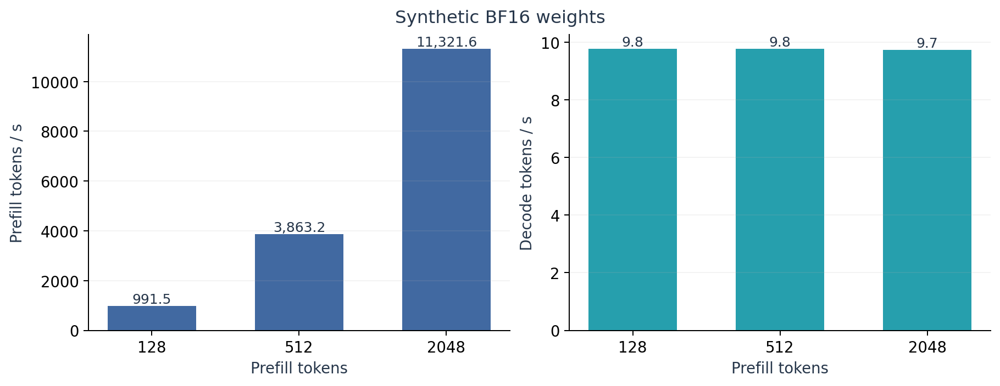

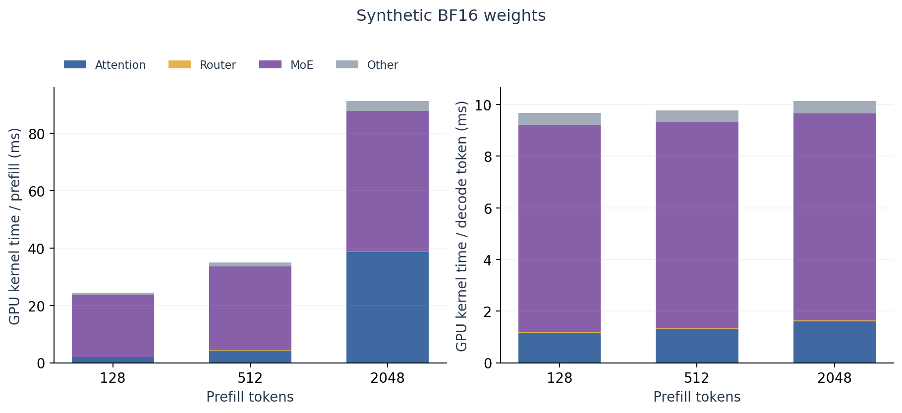

全架构 tracing 共覆盖 210,196 个 GPU kernel，所有内核均关联到 Prefill 或 Decode。公开 aggregate 覆盖完整 capture，timeline sample 每阶段最多保留前 256 个内核。decode 图按 8 步的 GPU kernel 总时间除以 8；原生吞吐来自独立进程。不能把两个运行的时间直接相减当作 CPU 时间。

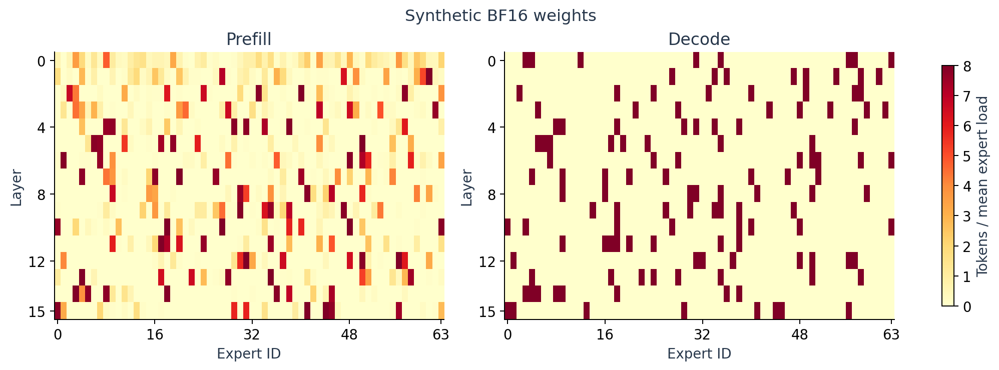

这是随机权重产生的实际 GPU router 分布，不能用于描述训练 checkpoint 的专家偏好。图中 decode 为独立未计时 pass 的一个缓存 Token。

完整结果和图表由同目录的数据生成。全架构 Nsight 的 Router 标签只包围 gate projection；softmax/top-k 仍归在 MoE 范围内。对 CPU Python 调度较多的 eager reference，不能将这些吞吐当作生产服务的性能上限。

## FlashGPU-Sim 与回归

保留已验证的 BF16 tensor 原始位捕获、RN-even scalar/packed BF16 转换修复，以及 worktree 的 `git -C` 版本检测。BF16 转换测试在硬件和仿真中均通过；原有 GEMM 回归为 73,038 cycles。BF16 转换 timing 仍未重新标定。

| 形状 / 内核 | cycles |
| --- | ---: |
| T=1，单专家 Gate / Up / Down | 43224 / 43224 / 26030 |
| T=1，单专家 SwiGLU | 9472 |
| T=16，H=2048，Dispatch | 8355 |
| 同形状 Combine | 10080 |
| 仅回复出口 1 → 2 sectors/cycle，Combine | 10081 |

回复出口加宽在该点没有收益，不能认定它是主瓶颈。独立 launcher 是新进程、冷缓存，不能累加成完整 MoE 延迟。完整 64 专家并发的全尺寸仿真扫描尚未完成。

## 数据与复现

- [历史基线](results/moe-baseline)：32 组硬件记录、13 次成功仿真和回归证据，日志已脱敏，日志哈希针对公开版本重算。
- [GPU 评估数据](results/moe-gpu)：扩展硬件测试、逐阶段 tracing、调度控制及全架构结果。
- [运行说明](../../tests/moe/README.md)：普通用户 profiling、原生测试、模拟器回放和绘图命令。
- [draw.io 源文件](figures/moe)：可编辑架构与方案图，另提供 PNG；测量图另提供 SVG 和生成脚本。

公开材料的路径以 `${REPO}` / `${HOME}` 代替实际目录；不发布原始 `.nsys-rep` / SQLite 文件。配置、库与捕获的哈希保留，采集日期、主机唯一标识与账户信息移除。

后续需要训练 checkpoint 以研究真实路由和文本推理，需要管理员授权性能计数器以校准 DRAM/L2；普通用户 tracing 已完成可用的内核与执行时间测量。
